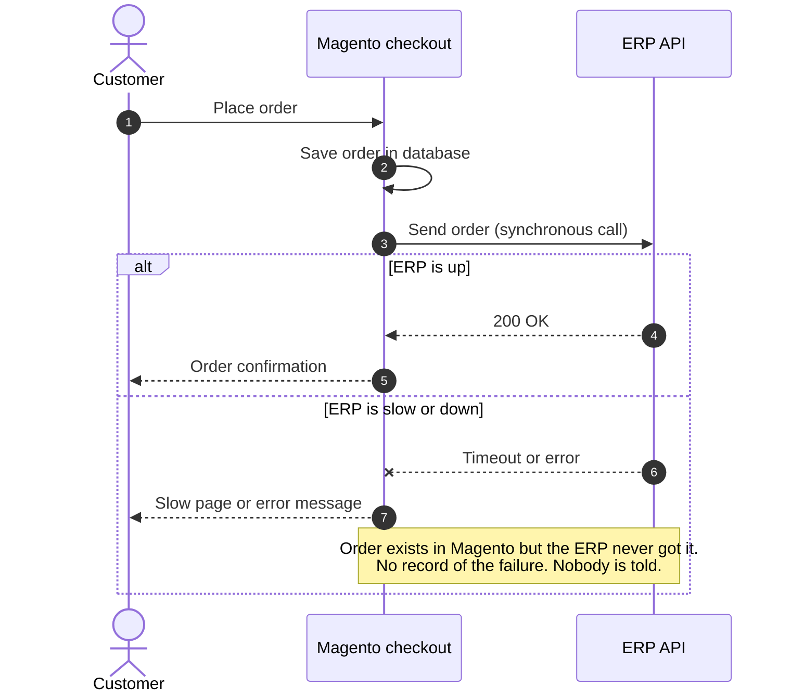
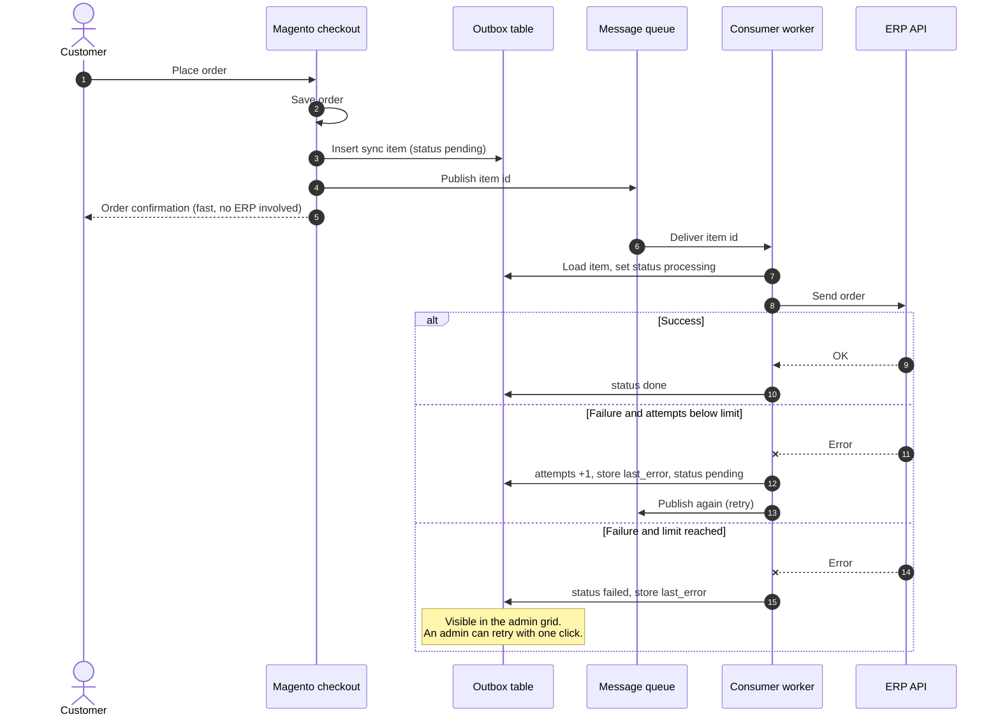
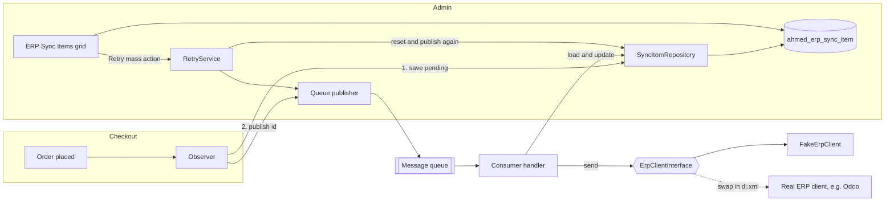
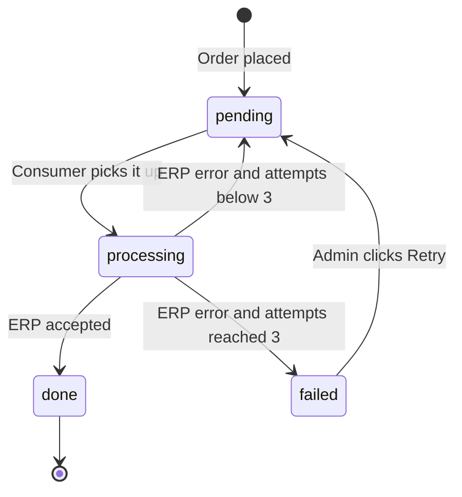
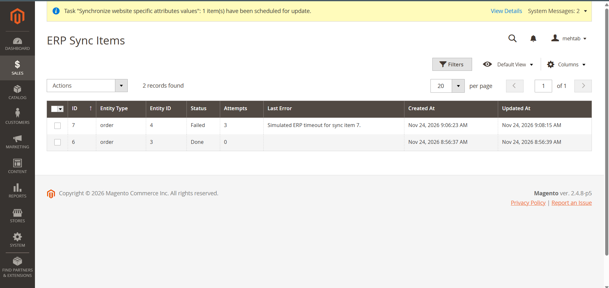
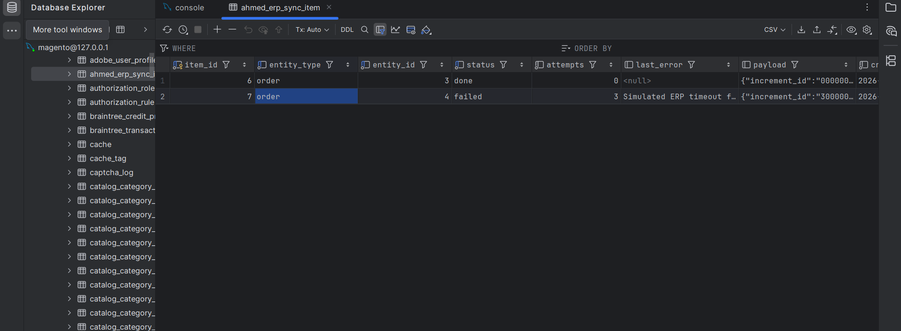

# Ahmed_ErpSyncMonitor

A Magento 2 module that sends orders to an ERP **reliably**, using the outbox pattern, a message queue, automatic retries and an admin grid to see and fix failures.


> Built as a showcase project. The ERP is simulated by a fake client that fails randomly, so retries can be demonstrated without a real ERP. A real client (for example for Odoo) plugs in behind the same interface.

---

## 1. The problem

Every shop that talks to an ERP has the same weak spot: **the moment an order is placed, something has to tell the ERP.**

The obvious solution is to call the ERP API directly while the customer checks out. It works until the ERP is slow, down, or returns an error.

### Flow without the outbox pattern



What goes wrong:

| Risk | Result |
| --- | --- |
| ERP is down | Checkout is slow or fails, the customer leaves |
| ERP call fails after the order is saved | The order exists in Magento but never reaches the ERP, and nobody knows |
| Temporary network problem | A one second glitch becomes a permanently lost order |
| Someone asks "did order 4 reach the ERP?" | No answer, because nothing was recorded |

---

## 2. The solution: outbox pattern with a queue

Do not talk to the ERP during checkout. Instead:

1. Write a small **sync record** into your own table (the outbox). It says "this order still has to be sent."
2. Put the record id on a **message queue**.
3. A **background consumer** picks it up, calls the ERP, and updates the record.
4. If the call fails, **retry** a few times. After the limit, mark it `failed` so an admin can see it and retry it.

The checkout only does a fast database write. The ERP can be down for an hour and no order is lost.

### Flow with the outbox pattern



What changes:

| Before | After |
| --- | --- |
| Checkout waits for the ERP | Checkout never touches the ERP |
| Failures are invisible | Every attempt, error and status is stored |
| One glitch loses an order | Automatic retries absorb temporary errors |
| No way to fix a failure | Admin grid with a Retry mass action |

---

## 3. Architecture



### Components

| Part | Location | Responsibility |
| --- | --- | --- |
| Service contracts | `Api/`, `Api/Data/` | Public interfaces: `SyncItemInterface`, `SyncItemRepositoryInterface`, ERP client interface |
| Model, resource model, collection | `Model/` | Persistence of sync items |
| Repository | `Model/SyncItemRepository.php` | Save, load, list, delete. Converts DB errors to Magento exceptions |
| Status constants | `Model/Status.php` | `pending`, `processing`, `done`, `failed` |
| Observer | `etc/events.xml` | Reacts to a placed order, creates the sync item and publishes it |
| Queue config | `etc/communication.xml`, `queue_*.xml` | Topic `ahmed.erp.sync.item`, consumer `ahmed.erp.sync.consumer` |
| Consumer handler | `Model/Queue/` | Sends to the ERP, updates status, retries or gives up |
| ERP client | `Model/` | `FakeErpClient` (fails about 40 percent of the time) behind an interface |
| Retry service | `Model/Retry/RetryService.php` | Resets failed items to pending and publishes them again |
| Admin UI | `Controller/Adminhtml/`, `view/adminhtml/` | Grid, filters, Retry mass action, ACL |
| Tests | `Test/Unit/` | Handler paths (success, retry, final failure) and the retry service |

### Status lifecycle



`attempts` counts **failed** tries. An item that succeeds on the first call shows `attempts = 0`.

---

## 4. Screenshots

**Admin grid.** One item delivered, one failed after three attempts:



**The outbox table in the database:**



---

## 5. Design decisions

**Why not call the ERP directly?**
Checkout speed and reliability should not depend on an external system.

**Why a table when there is already a queue?**
The queue is transport. The table is the record. It shows status, attempts and the last error to an admin, and it survives if a queue message is lost.

**Why retry only a few times?**
Most errors are temporary, so retrying is cheap. Endless retries against a broken system make things worse. After the limit the item is marked `failed` and a human decides.

**Why an interface for the ERP client?**
The consumer only knows `ErpClientInterface`. Replacing the fake with a real client is a one line change in `di.xml`, and tests can use a mock.

**Why service contracts and a repository?**
Other code depends on `Api/` interfaces, so internals can change without breaking callers. The repository is the single place that talks to the database.

**Why a small retry service instead of logic in the controller?**
The controller only handles the request. The work lives in a class that can be unit tested without a browser or a database.

**Why the DB queue?**
It runs on any Magento install with no extra service. The same configuration works with RabbitMQ by changing the queue connection.

**Compatibility.**
Only core framework APIs are used, so the module is intended to run on both Magento Open Source and Adobe Commerce. Tested on Magento 2.4.8, PHP 8.3.

---

## 6. Installation

Requirements: Magento 2.4.7 or newer, PHP 8.2 or 8.3.

From a local checkout (how it was developed):

```bash
composer config repositories.erp-sync path ../projects/magento2-erp-sync-monitor
composer require ahmed/module-erp-sync-monitor:@dev
bin/magento module:enable Ahmed_ErpSyncMonitor
bin/magento setup:upgrade
bin/magento setup:di:compile
bin/magento cache:flush
```

From GitHub:

```bash
composer config repositories.erp-sync vcs https://github.com/YOUR_USERNAME/magento2-erp-sync-monitor
composer require ahmed/module-erp-sync-monitor:dev-main
```

---

## 7. Try it

1. Place a test order.
2. Look at the outbox table. A new row appears with status `pending`:
   ```sql
   SELECT item_id, entity_id, status, attempts, last_error
   FROM ahmed_erp_sync_item ORDER BY item_id DESC;
   ```
3. Run the consumer:
   ```bash
   bin/magento queue:consumers:start ahmed.erp.sync.consumer --max-messages=1
   ```
4. Refresh the table or open **Sales > ERP Sync Items** in the admin. The row is `done`, or it went back to `pending` with a higher `attempts` after a simulated failure.
5. For a `failed` item, select it in the grid and use **Actions > Retry**.

---

## 8. Tests and CI

```bash
vendor/bin/phpunit -c dev/tests/unit/phpunit.xml.dist path/to/module/Test/Unit
```

GitHub Actions runs on every push: the Magento coding standard (PHPCS) and the unit tests against a fresh Magento built from the Mage-OS mirror.

---

## 9. Known limitations

Written down on purpose, because they are the next things to fix:

- **Stuck items.** If a consumer crashes while an item is `processing`, it stays that way. A cleanup job should reset stale items after a timeout.
- **No idempotency.** If the same message is processed twice, the ERP could receive the order twice. A real client should send the order number as a unique key.
- **No backoff.** Retries happen immediately. Exponential delay would be kinder to a struggling ERP.
- **Simulated ERP.** `FakeErpClient` fails at random. The real integration is not part of this project.
- **No detail view or CLI yet.** Retry is available through the grid only.
- **Payload contains order data.** In a real shop, check what is stored and for how long.

## 10. Roadmap

- Real ERP client (for example Odoo) behind the existing interface
- CLI command to requeue failed items
- Detail view for one item with the full payload and error history
- Cleanup of stale `processing` items
- Exponential backoff between retries
- RabbitMQ configuration example
- Integration tests

---

## License

MIT
